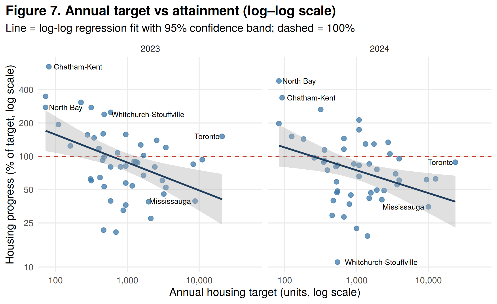
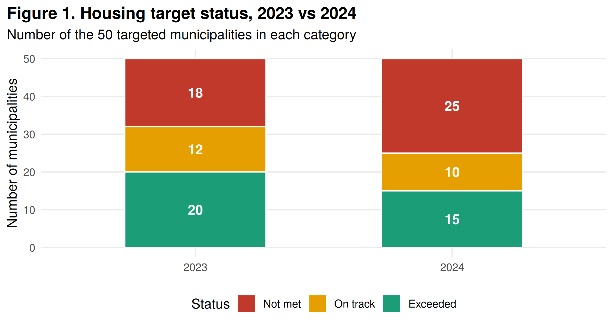

# Are Ontario's Municipalities Meeting Their Housing Targets?

An R analysis of Ontario's municipal housing-supply progress for 2023 and 2024: descriptive statistics, confidence intervals and hypothesis tests, bootstrapping, log-log regression, and repeated cross-validation.

**[Read the full report](docs/index.html)** (enable GitHub Pages on the `docs/` folder to view it online at `https://vyvjt.github.io/ontario-housing-targets/`)

<p align="center">
  
  
</p>

## Question

Ontario has a goal of building at least 1.5 million homes by 2031 and has assigned ten-year targets to its 50 largest and fastest-growing municipalities. Using the province's open data, this project asks:

1. Are municipalities meeting their annual housing targets?
2. What is the average attainment rate, and does it differ from 100%? Did it change between 2023 and 2024?
3. Is the size of a municipality's target related to how much of it is achieved?

## Key findings

| | 2023 | 2024 |
|---|---|---|
| Municipalities that exceeded target / fell below 80% | 20 / 18 | 15 / 25 |
| Combined attainment of the 50 municipalities | 96.7% | 74.2% |
| Mean attainment (95% CI) | 120.5% [89.8, 151.1] | 97.7% [73.9, 121.6] |
| Median attainment | 88.5% | 78.4% |

* The *average* municipality is statistically indistinguishable from 100% (one-sample t-test p = 0.186 and 0.849; bootstrap BCa intervals agree). The mean is inflated by a few small municipalities.
* The mean drop from 2023 to 2024 (22.7 percentage points) is borderline: paired t-test p = 0.072, Wilcoxon p = 0.070, bootstrap BCa interval [0.2, 48.8].
* **Larger targets go with lower attainment.** In a log-log regression, doubling the annual target is associated with about 16% lower attainment (slope −0.252, 95% CI [−0.406, −0.098], p = 0.002); the result holds in 2024 and when Toronto or Chatham-Kent is dropped.
* Repeated 5-fold cross-validation: the log-log model cuts out-of-sample RMSE by about 14% versus predicting the mean; a plain linear model on the raw target does worse than the baseline.

## Methods at a glance

* **Cleaning and validation:** parse text percentages, trim a trailing space in one municipality name, drop the "Municipalities without targets" aggregate row from municipal-level analysis, and run automated consistency checks (percentages recomputed from units, status rule, cumulative-progress reconciliation).
* **Inference:** one-sample and paired t-tests with Wilcoxon signed-rank and bootstrap (BCa / percentile, 10,000 resamples) as robustness checks.
* **Regression:** linear, semi-log and log-log models compared via residual diagnostics, Cook's distance, bootstrap slope intervals and sensitivity checks that drop the most extreme observations.
* **Validation:** 50 × repeated 5-fold CV against an intercept-only baseline, plus a temporal hold-out (fit on 2023, predict 2024).

## Repository layout

```
├── report.Rmd            # analysis + narrative (all code is also shown in the report appendix)
├── R/load_data.R         # data loading, cleaning, reshaping
├── data/                 # the two official CSVs (2023, 2024)
├── assets/style.css      # report styling
├── docs/index.html       # rendered report (self-contained)
└── figures/              # figures produced when the report is knitted
```

## Reproduce

Requires R ≥ 4.1 and the packages `dplyr`, `tidyr`, `readr`, `stringr`, `ggplot2`, `scales`, `boot`, `knitr`, `rmarkdown`.

```r
install.packages(c("dplyr", "tidyr", "readr", "stringr", "ggplot2",
                   "scales", "boot", "knitr", "rmarkdown"))
rmarkdown::render("report.Rmd", output_file = "index.html", output_dir = "docs")
```

All random steps use fixed seeds, so results are reproducible. The data are bundled; `load_housing(use_online = TRUE)` in `R/load_data.R` re-downloads the live files instead.

## Data

[Ontario's housing supply progress](https://data.ontario.ca/en/dataset/ontario-s-housing-supply-progress), Ontario Ministry of Municipal Affairs and Housing, via the Ontario Data Catalogue. Contains information licensed under the [Open Government Licence – Ontario](https://www.ontario.ca/page/open-government-licence-ontario). The bundled files are the January–December 2023 and 2024 releases as last updated in December 2025.

## Limitations

Only 50 municipalities and two years; the 2024 definition of progress is broader than 2023 (adds student beds and retirement-home suites); the data count housing *starts*, not completions; annual targets ramp up over time; and the regression shows association, not causation (the target also sits in the denominator of the response, which makes percentages volatile for small targets).

## License

Code: MIT (see `LICENSE`). Data: Open Government Licence – Ontario.
